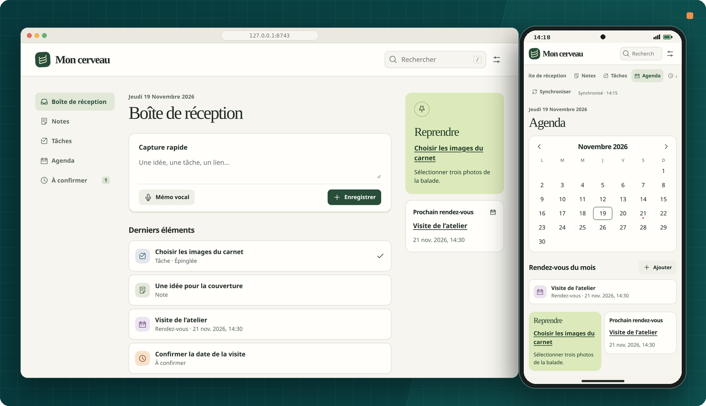

<p align="center"></p>
<h1 align="center">Mon cerveau</h1>
<p align="center">Une boîte de réception hors ligne et locale en priorité sur Android et Linux. Saisis une idée sur ton téléphone et retrouve le prochain geste à faire devant ton PC.</p>
<p align="center"><a href="https://github.com/everyday-tools-studio/my-brain/actions/workflows/checks.yml"></a> <a href="LICENSE"></a> </p>
<p align="center"><a href="docs/fr/demarrage.md"><strong>Démarrer</strong></a> · <a href="docs/fr/donnees.md">Parcours des données</a> · <a href="CONTRIBUTING.md#français">Contribuer</a> · <a href="README.md" lang="en">English</a></p>



## Pourquoi Mon cerveau ?

- **Local en priorité.** La capture fonctionne hors ligne sur Android même quand le PC est éteint. La transcription vocale française et l’extraction des messages tournent sur tes appareils.
- **Une seule boîte de réception.** Notes, mémos vocaux, tâches et rendez-vous vivent au même endroit — capture d’abord, classe ensuite.
- **IA locale d’abord, fournisseur au choix ensuite.** Branche un modèle local (`Ollama`, `llama.cpp`) sans clé API, ou connecte ponctuellement ton propre compte **Claude**, **Codex / OpenAI** ou toute API HTTPS compatible.
- **Portable et maîtrisé.** Tes données restent en SQLite avec sauvegardes chiffrées GnuPG et export complet.

## Une journée avec Mon cerveau

| Quand tu… | Ce qui se passe |
| --- | --- |
| Dictes une idée loin de chez toi | L’audio reste écoutable sur ton téléphone. Dès que le mémo rejoint le PC, un modèle vocal français le transcrit localement pour que tu puisses le rechercher. |
| Reçois « RDV demain à 9 h. Pense à apporter le dossier. » | Si tu autorises l’accès aux messages, le téléphone peut en tirer un rendez-vous et une tâche. Une date incertaine rejoint **À confirmer** pour que tu la précises. |
| Rouvres un projet en cours | Épingle une tâche et écris le prochain geste concret. **Reprendre** le remet sous tes yeux à l’ouverture de l’application. |

Android 13+ et Linux partagent la même interface en français. Une fois appairés, les deux appareils échangent leurs modifications sur le Wi-Fi de la maison en HTTPS avec certificat vérifié.

## Essayer sur Linux

Depuis le dossier du projet, lance :

```sh
./scripts/lancer-pc
```

Ouvre [Mon cerveau sur ce PC](http://127.0.0.1:8743). Saisis une note, transforme-la en tâche et épingle-la. Tu peux déjà essayer ce parcours avant d’associer ton téléphone. Le premier lancement télécharge les dépendances Python et le modèle de voix français.

**Distribution Android.** L’application se compile actuellement depuis les sources. F-Droid ne l’a ni examinée ni publiée. Le [guide de démarrage](docs/fr/demarrage.md) détaille les prérequis, la compilation, les autorisations et la première synchronisation.

## Fonctionnement

```text
Capture Android  ⇄  Wi-Fi local · HTTPS avec certificat vérifié  ⇄  PC Linux
   │                                                                 │
   ├─ Boîte de réception locale et mémos originaux                   ├─ SQLite et historique
   └─ Rappels de rendez-vous                                        ├─ Transcription française locale
                                                                     ├─ IA locale d’abord (Ollama / llama.cpp)
                                                                     └─ Fournisseur au choix et CLI agents
```

La détection repose sur des règles en français. Pour WhatsApp et les e-mails, elle dépend des aperçus transmis par Android. Une discussion en sourdine, un aperçu masqué ou une date dans une pièce jointe peuvent lui échapper. Vérifie la vue **À confirmer** lorsque tu essaies une nouvelle source.

## Guides du projet

- [Installation, appairage et dépannage](docs/fr/demarrage.md) — lance l’appli sur les deux appareils et vérifie un aller-retour.
- [Stockage, IA locale et fournisseurs](docs/fr/donnees.md) — suis le parcours des données, branche un modèle local ou ton compte Claude/Codex et crée une sauvegarde chiffrée.
- [Contribuer](CONTRIBUTING.md#français) · [Sécurité](SECURITY.md#français) · [Licence GPL-3.0-or-later](LICENSE).
