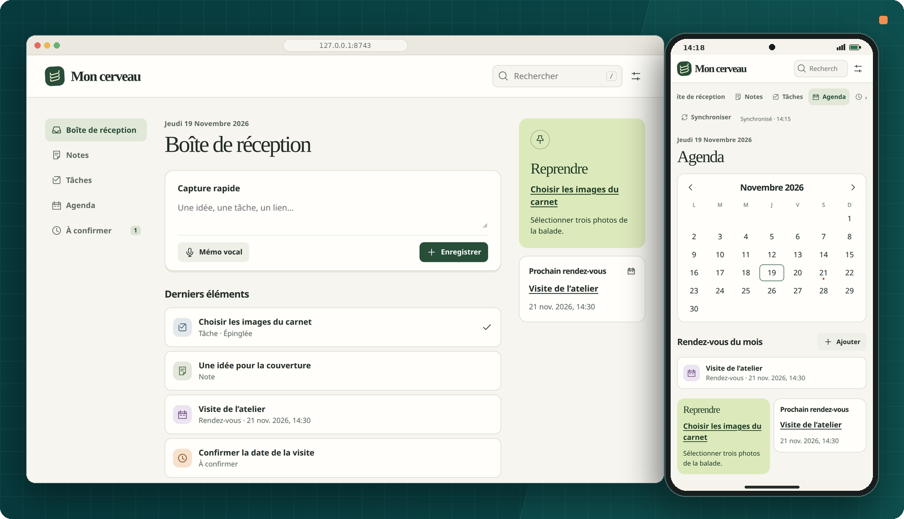

<p align="center"></p>
<h1 align="center">My Brain</h1>
<p align="center">An offline, local-first inbox for Android and Linux. Capture an idea on your phone, then pick up the next step at your desk.</p>
<p align="center"><a href="https://github.com/everyday-tools-studio/my-brain/actions/workflows/checks.yml"></a> <a href="LICENSE"></a> </p>
<p align="center"><a href="docs/en/getting-started.md"><strong>Get started</strong></a> · <a href="docs/en/data.md">Where your data goes</a> · <a href="CONTRIBUTING.md">Contribute</a> · <a href="README.fr.md" lang="fr">Français</a></p>



## Why My Brain?

- **Local-first by default.** Capture works offline on Android while your PC is asleep. French speech recognition and message extraction run on your own devices.
- **One inbox for everything.** Notes, voice memos, tasks, and appointments live together — save first, organize later.
- **Local AI first, bring your own provider when you want.** Connect a local model (`Ollama`, `llama.cpp`) with no API key, or opt in per message to your own **Claude**, **Codex / OpenAI**, or OpenAI-compatible HTTPS provider.
- **Portable and private.** Your data stays in SQLite with GPG-encrypted backups and full export.

## A day with My Brain

| When you… | What happens |
| --- | --- |
| Dictate an idea away from home | The audio stays playable on the phone. Once the memo reaches your PC, a local French speech model transcribes it for search. |
| Receive “RDV demain à 9 h. Pense à apporter le dossier.” | With message access enabled, the phone can turn the first sentence into an appointment and the second into a task. An uncertain date goes into **À confirmer** for you to check. |
| Return to a half-finished project | Pin one task and write the next concrete action. **Reprendre** brings it back into view when you open the app. |

Android 13+ and Linux share the same French interface. Pair the two once and they exchange changes over your home Wi-Fi with pinned HTTPS.

## Try it on Linux

From the project directory, run:

```sh
./scripts/lancer-pc
```

Open [My Brain on this PC](http://127.0.0.1:8743). Write a note, turn it into a task and pin it. You can try this before pairing a phone. First launch downloads Python dependencies and a French speech model.

**Android distribution:** build from source for now. F-Droid has not reviewed or published this app. The [setup guide](docs/en/getting-started.md) covers prerequisites, Android builds, permissions and the first sync.

## How it fits together

```text
Android capture  ⇄  Home Wi-Fi · pinned HTTPS  ⇄  Linux desktop
   │                                                  │
   ├─ Local inbox and original recordings             ├─ SQLite and revision history
   └─ Appointment reminders                          ├─ Local French speech recognition
                                                      ├─ Local AI first (Ollama / llama.cpp)
                                                      └─ Optional BYO provider & agent CLI
```

Message detection uses French-language rules. WhatsApp and email depend on the previews Android actually delivers. A muted chat, a hidden preview or a date inside an attachment can be missed. Keep an eye on **À confirmer** when trying a new message source.

## Project guides

- [Install, pair and troubleshoot](docs/en/getting-started.md) — run the app on both devices and verify a round trip.
- [Storage, local AI and optional providers](docs/en/data.md) — see where data goes, connect a local model or your own Claude/Codex provider, and export encrypted backups.
- [Contribute](CONTRIBUTING.md) · [Security](SECURITY.md) · [GPL-3.0-or-later license](LICENSE).
